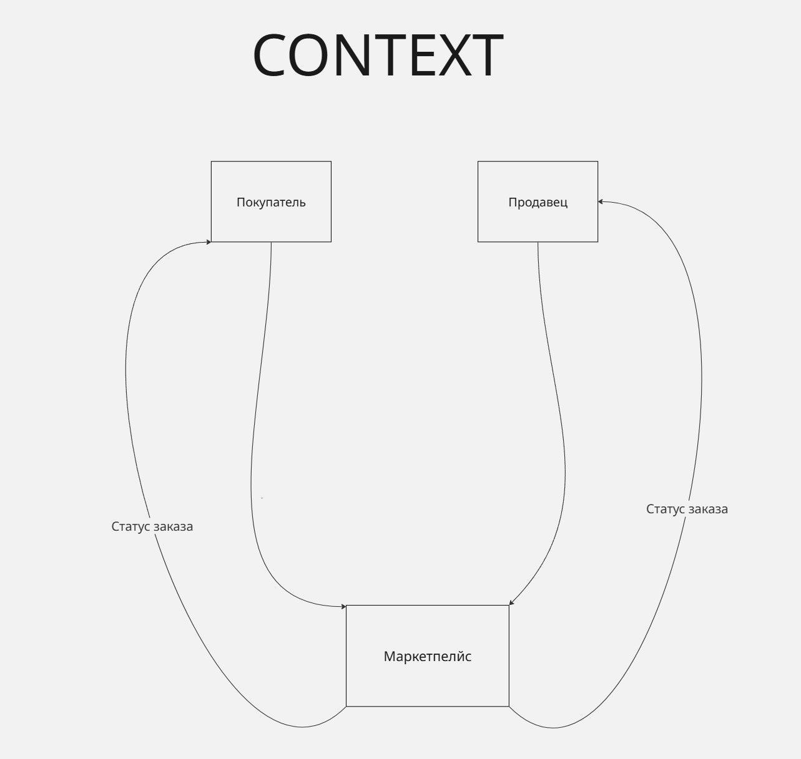
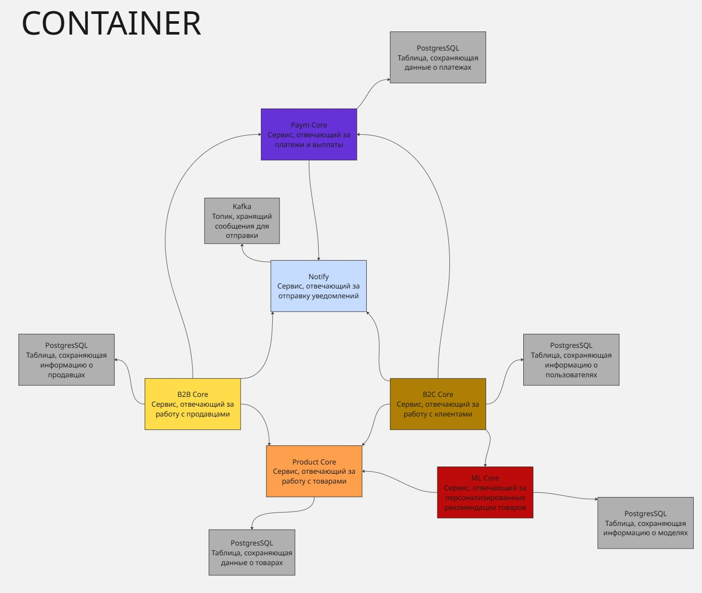
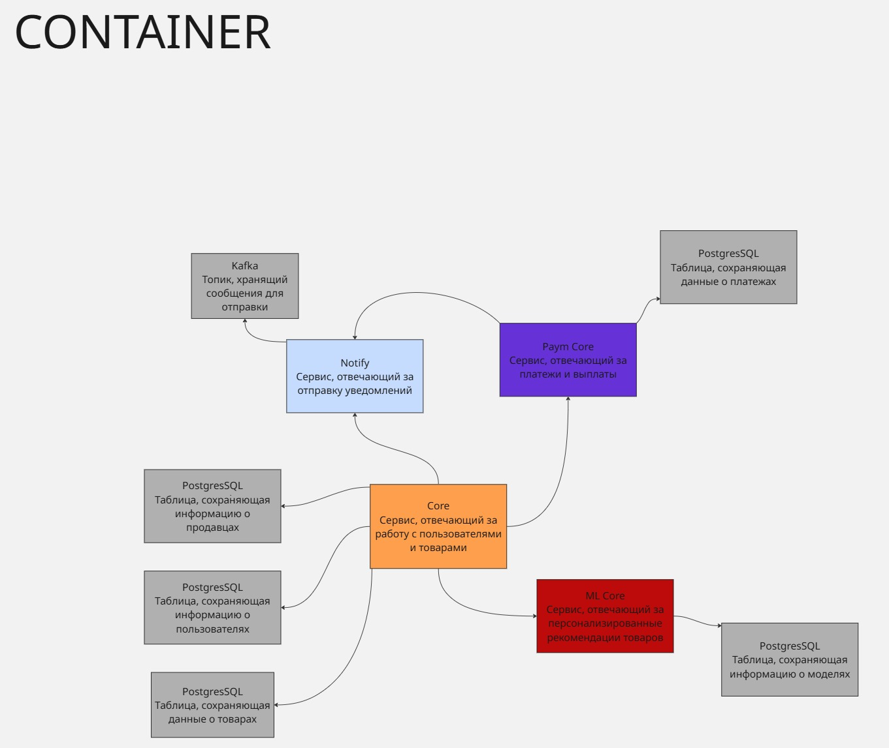

# Архитектурное проектирование системы маркетплейса

## Оглавление

1. [Описание проекта](#1-описание-проекта)
2. [C4-диаграммы](#2-c4-диаграммы)
3. [Сервис в Docker](#3-сервис-в-docker)
4. [Домены и зоны ответственности](#4-домены-и-зоны-ответственности)
5. [Распределение доменов по сервисам](#5-распределение-доменов-по-сервисам)
6. [Границы владения данными и взаимодействия](#6-границы-владения-данными-и-взаимодействия)
7. [Альтернативные варианты декомпозиции](#7-альтернативные-варианты-декомпозиции)
8. [Trade-off анализ](#8-trade-off-анализ)
9. [Обоснование финального выбора](#9-обоснование-финального-выбора)

---

## 1. Описание проекта

Маркетплейс - цифровая платформа, на которой продавцы размещают товары, а покупатели оформляют заказы. Система обеспечивает:

- Персонализированную выдачу ленты товаров (на основе ML-модели, учитывающей историю просмотров и покупок пользователя)
- Управление товарным каталогом (CRUD для продавцов)
- Управление пользователями (регистрация, аутентификация, профили покупателей и продавцов)
- Оформление заказов
- Расчёт и учёт платежей (оплата покупателями, вывод средств продавцами)
- Отправку уведомлений о статусах заказов

---

## 2. C4-диаграммы

Для каждого варианта архитектуры подготовлены четыре уровня C4-диаграмм.

### Уровень 1 - Context (общий для обоих вариантов)

Внешние акторы системы:

| Актор       | Описание                                                     |
| ----------- | ------------------------------------------------------------ |
| **Покупатель** | Просматривает каталог, оформляет заказы, получает уведомления о статусе заказа |
| **Продавец**   | Управляет товарами, получает уведомления о статусе заказа, выводит средства   |

Оба актора взаимодействуют с единой системой **«Маркетплейс»**, которая отправляет им уведомления о статусах заказов.

### Уровень 2 - Container

Диаграммы контейнерного уровня для обоих вариантов приведены в разделе [Альтернативные варианты декомпозиции](#7-альтернативные-варианты-декомпозиции).

- **Вариант 1** (6 сервисов): [Container диаграмма](solution_1/CONTAINER_1.jpg)
- **Вариант 2** (4 сервиса): [Container диаграмма](solution_2/CONTAINER_2.jpg)

### Уровень 3 - Component

- **Вариант 1**: [Component диаграмма](solution_1/COMPONENT_1.jpg)
- **Вариант 2**: [Component диаграмма](solution_2/COMPONENT_2.jpg)

### Уровень 4 - Code

- **Вариант 1**: [Code диаграмма](solution_1/CODE_1.jpg)
- **Вариант 2**: [Code диаграмма](solution_2/CODE_2.jpg)

---

## 3. Сервис в Docker

В качестве демонстрационного сервиса реализован **Notify** - сервис отправки уведомлений на Go. Отвечает `200 OK` на `GET /health`.

Инструкция по сборке/запуску: [notify/README.md](notify/README.md)

---

## 4. Домены и зоны ответственности

В системе маркетплейса выделены следующие бизнес-домены:

| Домен                     | Зона ответственности                                                                                                  |
| ------------------------- | --------------------------------------------------------------------------------------------------------------------- |
| **Управление покупателями (B2C)** | Регистрация, аутентификация и управление профилем покупателя. Хранение данных покупателей, истории просмотров. Оформление заказов, покупка товаров. |
| **Управление продавцами (B2B)**   | Регистрация, аутентификация и управление профилем продавца. Хранение данных продавцов. Инициация вывода средств.                                   |
| **Каталог товаров (Product)**     | CRUD-операции над товарами (создание, чтение, обновление, удаление). Хранение информации о товарах (название, описание, количество, фото).         |
| **Платежи (Payment)**             | Создание и обработка платёжных операций (оплата заказов). Создание и обработка выводов средств продавцами. Отслеживание статусов финансовых операций. |
| **Персонализация (ML)**           | Формирование персонализированной ленты товаров на основе модели. Хранение данных моделей и результатов предсказаний. Принимает на вход ID пользователя и возвращает ранжированный список товаров. |
| **Уведомления (Notification)**    | Отправка уведомлений о статусах заказов покупателям и продавцам. Асинхронное потребление событий из очереди сообщений (Kafka).                      |

---

## 5. Распределение доменов по сервисам

### Вариант 1 - Мелкозернистый (6 сервисов)

Каждому домену соответствует отдельный сервис:

| Сервис           | Домены                    | Логика разбиения                                                                                        |
| ---------------- | ------------------------- | ------------------------------------------------------------------------------------------------------- |
| **B2C Core**     | Управление покупателями   | Покупатели и продавцы - принципиально разные роли с разными сценариями, разделение позволяет развивать и нагружать их независимо. |
| **B2B Core**     | Управление продавцами     | Продавцы имеют свои экраны, свою авторизацию и свой набор действий - логично держать их отдельно.        |
| **Product Core** | Каталог товаров           | Каталог просматривают гораздо чаще, чем редактируют - выделение позволяет усиливать его отдельно от остальных частей системы. |
| **Paym Core**    | Платежи                   | Деньги - зона повышенного контроля; финансы должны быть изолированы от остальных сервисов для безопасности и учёта. |
| **ML Core**      | Персонализация            | Рекомендательные модели обновляются по своему графику (обучение → проверка → выкатка) и требуют отдельных вычислительных ресурсов. |
| **Notify**       | Уведомления               | Уведомления отправляются в фоне и не должны тормозить основной процесс оформления заказа.               |

### Вариант 2 - Крупнозернистый (4 сервиса)

Домены пользователей и каталога объединены в один сервис:

| Сервис           | Домены                                                      | Логика разбиения                                                                                      |
| ---------------- | ----------------------------------------------------------- | ----------------------------------------------------------------------------------------------------- |
| **Core**         | Управление покупателями + Управление продавцами + Каталог   | Объединение упрощает систему: меньше частей - меньше связей между ними и проще поддерживать.            |
| **Paym Core**    | Платежи                                                     | Финансы отдельно - так требуют безопасность и учёт.                                                    |
| **ML Core**      | Персонализация                                              | Рекомендации вынесены отдельно из-за особых требований к ресурсам и своего графика обновления моделей.  |
| **Notify**       | Уведомления                                                 | Работает в фоне, не связан с основным процессом покупки.                                              |

---

## 6. Границы владения данными и взаимодействия

### Владение данными

Каждый сервис владеет своей базой данных - **ни одна база не используется двумя сервисами одновременно**. Это гарантирует, что изменения в одном сервисе не сломают данные другого.

#### Вариант 1 (6 сервисов)

| Сервис           | Хранилище данных               | Какими данными владеет                                                         |
| ---------------- | ------------------------------ | ------------------------------------------------------------------------------ |
| **B2C Core**     | PostgreSQL (своя база)         | Профили покупателей, история просмотров, заказы покупателей                     |
| **B2B Core**     | PostgreSQL (своя база)         | Профили продавцов, данные о магазинах                                          |
| **Product Core** | PostgreSQL (своя база)         | Карточки товаров (название, описание, количество, фото, цена)                  |
| **Paym Core**    | PostgreSQL (своя база)         | Платежи, выводы средств, статусы операций                                      |
| **ML Core**      | PostgreSQL (своя база)         | Данные моделей рекомендаций, результаты предсказаний                            |
| **Notify**       | Kafka (очередь сообщений)      | Очередь уведомлений для отправки; долгосрочно данные не хранятся               |

#### Вариант 2 (4 сервиса)

| Сервис           | Хранилище данных                                        | Какими данными владеет                                                             |
| ---------------- | ------------------------------------------------------- | ---------------------------------------------------------------------------------- |
| **Core**         | 3 отдельные PostgreSQL (покупатели, продавцы, товары)   | Профили покупателей и продавцов, каталог товаров, заказы                            |
| **Paym Core**    | PostgreSQL (своя база)                                  | Платежи, выводы средств, статусы операций                                          |
| **ML Core**      | PostgreSQL (своя база)                                  | Данные моделей рекомендаций                                                        |
| **Notify**       | Kafka (очередь сообщений)                               | Очередь уведомлений                                                                |

### Взаимодействие между сервисами

| Источник         | Получатель       | Способ                         | Описание                                                        |
| ---------------- | ---------------- | ------------------------------ | --------------------------------------------------------------- |
| B2C Core / Core  | Product Core*    | Синхронное (запрос-ответ)      | Получение списка товаров, информации о конкретном товаре         |
| B2C Core / Core  | Paym Core        | Синхронное (запрос-ответ)      | Создание платежа при оформлении заказа                           |
| B2B Core / Core  | Product Core*    | Синхронное (запрос-ответ)      | Создание, обновление, удаление товаров от имени продавца         |
| B2B Core / Core  | Paym Core        | Синхронное (запрос-ответ)      | Создание запроса на вывод средств                                |
| B2C Core / Core  | ML Core          | Синхронное (запрос-ответ)      | Запрос персонализированной ленты товаров для покупателя          |
| Paym Core        | Notify           | **Асинхронное (через очередь Kafka)** | Отправка события об изменении статуса платежа / заказа    |
| B2C Core / Core  | Notify           | **Асинхронное (через очередь Kafka)** | Отправка события о создании / изменении статуса заказа    |
| Notify           | Покупатель       | Push / Email / SMS             | Отправка уведомления покупателю                                  |
| Notify           | Продавец         | Push / Email / SMS             | Отправка уведомления продавцу                                    |

> \* В Варианте 2 Product Core не существует как отдельный сервис - работа с товарами происходит внутри Core напрямую, без обращения по сети.

**Почему два способа взаимодействия:**
- **Синхронное (запрос-ответ)** - когда нужен немедленный ответ, чтобы продолжить работу (например, показать товар или создать платёж).
- **Асинхронное (через очередь)** - когда результат не нужен прямо сейчас (например, отправка уведомления). Если сервис уведомлений временно не работает, сообщения сохраняются в очереди и будут отправлены, когда он восстановится.

---

## 7. Альтернативные варианты декомпозиции

### Вариант 1 - Мелкозернистый (6 сервисов)

**Сервисы:** B2C Core, B2B Core, Product Core, Paym Core, ML Core, Notify

Каждый бизнес-домен выделен в отдельный независимый сервис. Покупатели и продавцы полностью разделены, каталог товаров - тоже отдельно.

**Плюсы:**

- ✅ **Независимое усиление**: если каталог перегружен - усиливаем только его, не трогая остальные части системы.
- ✅ **Независимые обновления**: изменения для продавцов выкатываются отдельно от покупателей; одно не ломает другое.
- ✅ **Понятные зоны ответственности**: каждая команда отвечает за свой сервис - нет пересечений и споров «кто это должен чинить».
- ✅ **Изоляция сбоев**: если сломался каталог, профили покупателей продолжают работать.

**Минусы:**

- ❌ **Сложнее в обслуживании**: 6 сервисов, 5 баз данных + очередь сообщений = больше серверов, больше мониторинга, больше работы для инженеров.
- ❌ **Медленнее ответ**: покупка товара проходит через цепочку вызовов между сервисами (покупатель → каталог → платежи), каждый шаг добавляет время ожидания.
- ❌ **Сложность согласования данных**: оформление заказа затрагивает данные в нескольких сервисах одновременно; нужны дополнительные механизмы, чтобы данные не рассогласовались.
- ❌ **Повторяющийся код**: сервисы покупателей и продавцов содержат одинаковые модули авторизации и обработки запросов.

---

### Вариант 2 - Крупнозернистый (4 сервиса)

**Сервисы:** Core, Paym Core, ML Core, Notify

Покупатели, продавцы и каталог объединены в единый сервис **Core**. Платежи, рекомендации и уведомления остаются отдельными.

**Плюсы:**

- ✅ **Проще в обслуживании**: 4 сервиса вместо 6 - меньше серверов, меньше настроек, проще следить.
- ✅ **Быстрее ответ внутри Core**: обращение к товарам из модуля покупателя происходит мгновенно внутри одного сервиса, без обращения по сети.
- ✅ **Проще работать с данными**: создание заказа (пользователь + товар) происходит в одной базе данных, нет риска рассогласования.
- ✅ **Нет дублирования**: один модуль авторизации на оба типа пользователей.

**Минусы:**

- ❌ **Нельзя усиливать по частям**: нагрузка на каталог и на профили пользователей растёт вместе - нельзя добавить мощности только для каталога.
- ❌ **Больше зона поражения**: ошибка в модуле товаров может уронить всю работу с пользователями и наоборот.
- ❌ **Риск превращения в монолит**: со временем границы внутри Core размываются, код запутывается, становится сложно вносить изменения.
- ❌ **Совместные обновления**: любое изменение в любом из трёх доменов Core требует обновления всего сервиса целиком.

---

## 8. Trade-off анализ

| Критерий                          | Вариант 1 (6 сервисов)                              | Вариант 2 (4 сервиса)                                |
| --------------------------------- | --------------------------------------------------- | ---------------------------------------------------- |
| **Сложность обслуживания**        | Высокая (6 сервисов + 5 БД + очередь)               | Умеренная (4 сервиса + 4 БД + очередь)               |
| **Скорость ответа**               | Ниже (цепочки вызовов между сервисами)              | Выше (внутри Core всё рядом)                         |
| **Возможность усиления по частям**| Точечная (каждый сервис отдельно)                    | Грубая (Core усиливается целиком)                    |
| **Устойчивость к сбоям**          | Высокая (сбой одного сервиса не роняет остальные)    | Средняя (сбой Core затрагивает 3 домена)             |
| **Работа с данными**              | Сложнее (данные в разных базах, нужно согласовывать) | Проще (данные рядом, одна транзакция)                |
| **Скорость старта разработки**    | Ниже (больше настроек)                               | Выше (проще начать)                                  |
| **Автономность команд**           | Высокая (каждая команда - свой сервис)               | Средняя (Core разрабатывает одна команда)            |
| **Повторение кода**               | Есть (авторизация дублируется)                       | Нет                                                  |

**Ключевые trade-off'ы:**

1. **Точечное усиление vs. сложность обслуживания.** Вариант 1 позволяет усиливать каждый домен отдельно, но каждый дополнительный сервис - это отдельный сервер, отдельный мониторинг, отдельное дежурство. Вариант 2 жертвует гибкостью ради простоты.

2. **Автономность команд vs. целостность данных.** Вариант 1 даёт командам полную независимость (каждая обновляет свой сервис), но оформление заказа затрагивает данные в нескольких базах - нужны дополнительные механизмы, чтобы данные не разъехались. Вариант 2 хранит всё рядом и проще обеспечивает целостность, но команды вынуждены работать в одной кодовой базе.

3. **Изоляция сбоев vs. скорость ответа.** Вариант 1 изолирует сбои (сломался каталог - профили работают), но каждый запрос на покупку проходит через несколько сервисов и это занимает время. Вариант 2 быстрее отвечает, но если что-то сломалось в Core - не работает всё сразу.

---

## 9. Обоснование финального выбора

### Выбран: Вариант 1 - Мелкозернистый (6 сервисов)

1. **Разная нагрузка.** Каталог - много чтений, продавцы - тяжёлые записи, платежи - мало запросов, но каждый критичен. Отдельные сервисы позволяют усиливать каждую часть независимо.

2. **Изоляция финансов.** Платежи изолированы от остальной системы - требование безопасности и учёта.

3. **Разные требования к скорости.** Покупатель оформляет заказ - важна каждая секунда. Продавец загружает товар - задержка допустима. Разделение позволяет настраивать это по отдельности.

4. **ML обновляется отдельно.** Рекомендательные модели живут по своему графику и требуют отдельных ресурсов.

5. **Команды работают независимо.** Один сервис - одна команда, нет блокировок.

6. **Сбоеустойчивость.** При падении одного сервиса остальные продолжают работать. Например, если сломался ML Core - покупатель не увидит персональные рекомендации, но всё ещё может искать товары и оформлять заказы. Система не разваливается целиком.

7. **Сложность допустима.** Согласование данных между сервисами сложнее, но для маркетплейса задержка синхронизации некритична (пользователь и так ждёт подтверждения оплаты).

